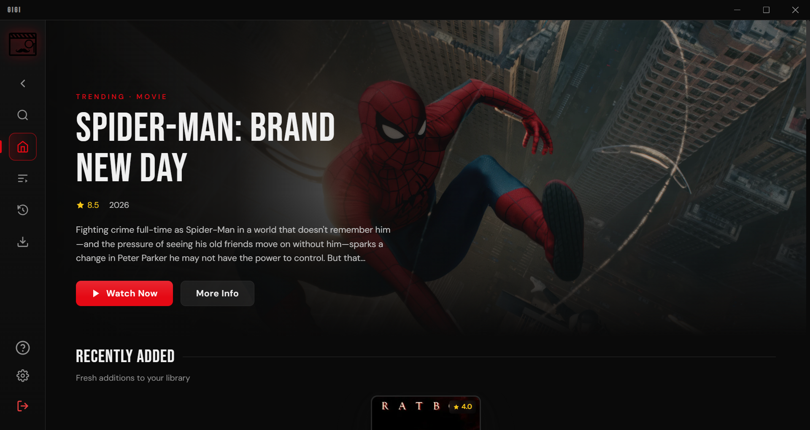
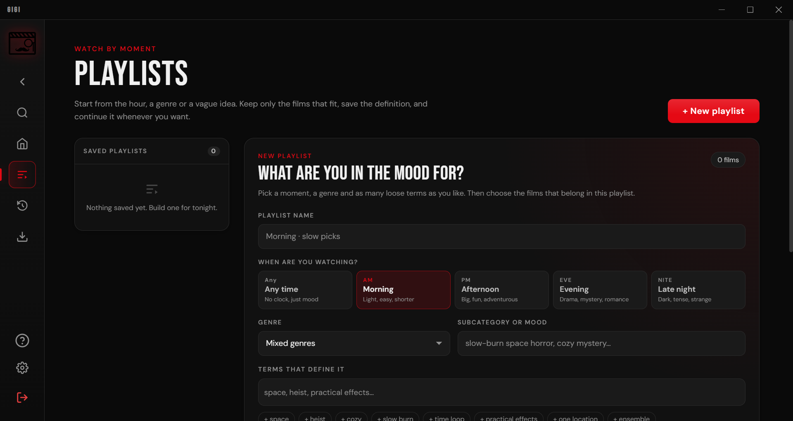
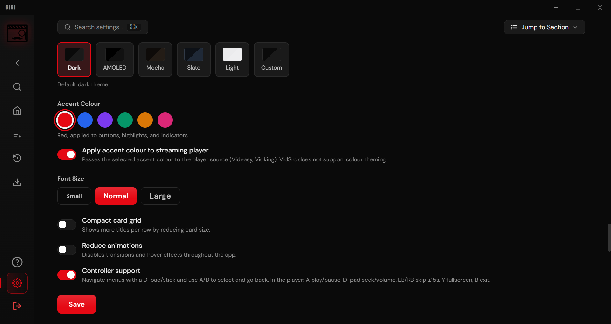

# Gigi

### A fast, private desktop app for movies, TV series and anime.

Gigi brings discovery, streaming, downloads, subtitles and a personal library into one focused desktop experience. It is built with Electron, React and SQLite — no Gigi account, no ads and no central tracking service.

<p align="center">
  <a href="https://github.com/necu/Gigi/releases/latest">
    
  </a>
  <br>
  <sub>Windows 10/11 · x64 · direct installer</sub>
</p>

[](#whats-new)
[](LICENSE)
[](#installation)
[](https://www.electronjs.org/)
[](https://react.dev/)

[Overview](#overview) · [Features](#features) · [Installation](#installation) · [First launch](#first-launch) · [How to use Gigi](#how-to-use-gigi) · [Troubleshooting](#troubleshooting) · [Development](#development-and-packaging) · [Credits](#credits-and-license)

---

## Overview

Gigi is a desktop media browser for people who want their watchlist, downloads and viewing progress in one place. Browse trending and recommended titles, open a movie or series, pick a source, and keep watching from the same library on the next launch.

The interface is dark by default, keyboard- and controller-friendly, and designed to stay out of the way while you browse.



## What's new

**Gigi 2.8.1** makes discovery and the library mood-first, opens full cast and person pages, and turns the player into a modern control deck:

- **Mood library:** a new panel asks what you want to feel, then filters by moment, emotion, company, rhythm and theme. Tags such as night, daytime, after lunch, joyful, sad or profound are derived automatically from TMDB metadata.
- **3D tag cloud:** expand the panel into a full-screen, tiltable sphere. Every bubble shows how many titles still match, suggestions appear as you refine, and the library behind it filters live.
- **Full-library tagging:** existing saved titles are backfilled quietly in the background; local tags and user edits are never overwritten.
- **Cast and crew panel:** every movie and series page now lists directors, top-billed cast and key crew inline, with the complete credits one click away.
- **Person pages:** open any actor, director or crew member to read their biography and full filmography, and add any of their titles to your library from the profile.
- **Search that forgives typos:** misspelled titles and names resolve to the closest match, and people can be opened straight from the search results.
- **Rotating home spotlight:** recommendations shaped by your history and the time of day, with trailer previews and a shortcut to your saved favourites.
- **Player deck:** animated play, rewind and forward controls in the centre, a scrubbable timeline, speed, mute, fullscreen and a configurable hold-to-seek interval.
- **Smarter skip intro:** a five-second halo appears on hover, auto-skips when complete, and leaves a five-second undo pill. AniSkip data is used when available, with a learned estimate for other series.
- **Resume exactly where you were:** opening Settings from a playing title and pressing Back returns to the player at the same second, episode and pause state.
- **Playback from every section:** opening a film, series or playlist title from Home, the Library or a saved playlist now loads its detail page and player correctly instead of failing with a blank error.
- **Menus no longer pause the film:** closing a provider's quality or audio menu with an outside click restores playback instead of leaving it paused.
- **Crisp Windows icon:** the app and the installer now carry a proper multi-resolution 32-bit icon, so Gigi stays sharp in the taskbar, Start menu and installer.
- The existing Streambert data directory and local database names are unchanged, so updating does not wipe your library.

## Features

| Area | What you get |
| --- | --- |
| **Discovery** | Trending movies and series, top-rated titles, recently added items and recommendations based on your library. |
| **Streaming** | Embedded player with multiple sources, source switching, HLS playback, trailers, fullscreen and external player support. |
| **Downloads** | Download streams, follow queue progress, scan local folders and keep downloaded subtitles together with the video. |
| **Library** | Save titles, track watch status and progress, filter by type, status, genre, tag, collection or year, and create reusable views. |
| **Playlists** | Build a playlist around a mood, time of day, genre or loose idea; save it and return to it later. |
| **Anime** | AniList metadata, AllManga sources, AniSkip intro skipping and the same library/download workflow as films and series. |
| **Subtitles** | Subtitle search and download, preferred language, automatic subtitle download and optional Wyzie Subs integration. |
| **Personalization** | Dark, AMOLED, Mocha, Slate and Light themes, six accent colours, font sizing, compact grids and reduced animations. |
| **Privacy** | Ad and tracker blocking in the player, local-first data, no account required and no central analytics service. |
| **Desktop extras** | Discord Rich Presence, desktop notifications, gamepad navigation, keyboard shortcuts and scheduled backups. |

### A closer look

<p align="center">
  
  
</p>

## Requirements

### For the prebuilt app

- Windows 10/11 (x64), macOS or a modern x64 Linux distribution.
- A free **TMDB API Read Access Token** for metadata, artwork and discovery.
- Internet access for metadata and streaming sources.
- Optional for downloads: `ffmpeg` and [vid-dl-cli-only](https://github.com/truelockmc/vid-dl-cli-only/releases/latest).

### For building from source

- [Node.js](https://nodejs.org/) **22.12.0 or newer**.
- npm (included with Node.js).
- The platform build tools required by Electron. On Linux, a working desktop environment and the usual GTK libraries are recommended.

## Installation

### Windows

<p align="center">
  <a href="https://github.com/necu/Gigi/releases/latest">
    
  </a>
</p>

Download the latest installer from the button above, run it and choose an installation folder, then launch **Gigi** from the Start menu. The installer is also generated locally by `npm run dist:win` as `dist/Gigi Setup 2.8.1.exe`.

The installer is not code-signed, so Windows SmartScreen may show a warning. Choose **More info → Run anyway** only if you trust the build and its source.

### Linux

Build a package for your distribution from source, then install it with the matching package manager.

```bash
npm ci
npm run dist:linux

# Debian / Ubuntu
sudo dpkg -i dist/gigi_*.deb

# Fedora / RPM-based distributions
sudo rpm -i dist/gigi-*.rpm

# Arch Linux
sudo pacman -U dist/gigi-*.pacman

# AppImage
chmod +x dist/Gigi-*.AppImage
./dist/Gigi-*.AppImage
```

If a package reports missing shared libraries, install the distribution's GTK/Electron runtime dependencies and try again.

### macOS

Build the unsigned universal disk image from source:

```bash
npm ci
npm run dist:mac
open dist/Gigi-*.dmg
```

Drag **Gigi** into **Applications**. On first launch, macOS may block the unsigned app: open **System Settings → Privacy & Security**, click **Open Anyway**, and confirm.

### Build from source

Use this if you want the newest code, a custom build, or a package for another architecture.

```bash
git clone https://github.com/necu/Gigi.git
cd Gigi
npm ci
npm start
```

`npm start` builds the renderer and launches Electron. To produce installers:

```bash
npm run dist:win      # Windows NSIS installer
npm run dist:linux    # .deb, .rpm, .pacman and AppImage
npm run dist:mac      # unsigned universal .dmg
```

Build outputs are written to `dist/`.

## First launch

1. Create a free [TMDB](https://www.themoviedb.org/) account if you do not have one.
2. Open [TMDB API settings](https://www.themoviedb.org/settings/api) and request a **Personal use** API key.
3. Copy the **API Read Access Token** — the long value starting with `eyJ`, not the shorter API Key.
4. Paste it into Gigi's setup screen and press **Let's go**.

The token is stored locally using Electron's secure storage where available. It is only used to request metadata from TMDB. A full walkthrough is available in [tmdb-tutorial.md](tmdb-tutorial.md).

You can skip setup and add the token later from **Settings → General → TMDB Read Access Token**.

## How to use Gigi

### Home

Home is the starting point for browsing. It can show:

- **Continue Watching** — titles with saved playback progress.
- **Recently Added** — fresh additions to your library.
- **Recommended for You** — picks based on your saved titles and viewing history.
- **Trending Movies** and **Trending Series** — currently popular titles.
- **Top Rated** — highly rated films and series.

Use the row arrows to browse horizontally. You can reorder or hide rows in **Settings → Home Page Layout**, and choose a different start page in **Settings → Start Page**.

### Search and command palette

- Press `Ctrl+F` to open search.
- Press `Ctrl+Shift+P` to open the command palette.
- Press `Ctrl+K` to focus search on the current page.
- Press `Esc` to close a modal or search.
- Press `?` to open the full shortcut reference.

Search results can be opened directly, and the command palette is the quickest way to jump around the app.

### Movies and series

Open any poster to see its details, cast, related titles, seasons and episodes. From a title page you can:

- Play a source in the embedded player.
- Switch between available sources.
- Watch the trailer.
- Save the title to your library or a playlist.
- Start a download.
- Open subtitles, related titles and cast pages.
- Mark progress, episodes and watched status.

The player supports fullscreen, volume and seeking controls. When a source fails, try another source before assuming the title is unavailable.

### Library and watch history

**Library & History** is your personal collection:

- **Saved** titles you want to watch.
- **Planned**, **Watching** and **Completed** status filters.
- **Continue Watching** progress rows.
- **Watch History** with the ability to remove individual entries.
- Filters for movies, series and anime, plus genres, tags, collections and release years.
- Saved custom views for filters you use often.
- **Organize** tools for genres, directors, decades, franchises and saga order.
- Bulk selection for moving, tagging and removing multiple titles.

Library data is stored in SQLite when the desktop database is available, with local storage as a fallback.

### Playlists

Playlists are built around a moment rather than a folder hierarchy. Choose a time of day, a genre and optional mood terms, then let Gigi suggest films for that playlist. Save the definition and return to it whenever you want the same kind of evening.

The playlist builder is useful for things like:

- *Morning · light picks*
- *Late night · slow-burn space horror*
- *Weekend · practical-effects action*
- *Cozy mystery · one location*

### Downloads

Open a movie or episode and choose **Download** to add it to the download queue. Downloading requires:

- `ffmpeg` available to Gigi.
- [vid-dl-cli-only](https://github.com/truelockmc/vid-dl-cli-only/releases/latest) installed and configured.

In **Downloads** you can:

- See active and completed downloads.
- Sort and filter the queue.
- Set a download folder in **Settings → Downloads**.
- Scan a local folder for existing video files.
- Manage downloaded subtitles and playback progress.
- Open an error log when a download fails.

Available download quality and speed depend on the source and your connection.

### Anime

Anime titles are detected automatically. Gigi uses AniList metadata for anime and can use AniSkip to skip openings when timestamps are available. The same library, history and download tools apply to anime.

### Subtitles

Configure subtitle downloads in **Settings → Subtitles**:

- Choose a preferred language.
- Enable automatic subtitle downloads with videos.
- Use the default subtitle source or add a **Wyzie Subs** API key for more options.
- Manage downloaded subtitle files alongside the video.

### Appearance and accessibility

Open **Settings → Appearance** to change:

- Theme: Dark, AMOLED, Mocha, Slate, Light or a custom palette.
- Accent colour.
- Font size.
- Compact card grid.
- Reduced animations.
- Controller support.

The app is designed to work with a keyboard and a gamepad. See the shortcut and controller reference in-app with `?`.

### Backups and data

Use **Settings → Backup & Restore** to export a JSON backup containing your settings, library and playlists. Keep backups somewhere safe before resetting the app or moving to another computer.

You can also configure a backup folder and retention count. The app keeps the legacy `streambert_` local-storage namespace and `streambert.db` database name so existing data continues to work after the Gigi rename.

Typical user-data locations:

| Platform | Folder |
| --- | --- |
| Windows | `%APPDATA%\streambert` |
| macOS | `~/Library/Application Support/streambert` |
| Linux | `~/.config/streambert` |

Downloaded videos live in the folder configured in Settings, not in the user-data folder.

### Notifications and Discord

- **Desktop notifications** can alert you when downloads complete or new episodes are detected.
- **Discord Rich Presence** can show the title you are watching and a button linking to the project. Both features are optional and can be disabled in Settings.

## Keyboard shortcuts

| Shortcut | Action |
| --- | --- |
| `Ctrl+F` | Open global search |
| `Ctrl+Shift+P` | Open command palette |
| `Ctrl+K` | Search on the current page |
| `Esc` | Close search or modal |
| `Ctrl+Z` | Navigate back |
| `Ctrl+R` | Reload the app |
| `?` | Show keyboard shortcuts |

### Controller

| Control | Action |
| --- | --- |
| D-pad | Navigate menus |
| A | Select / confirm |
| B | Back / close |
| Start | Open search |
| A / D-pad / LB / RB | Player: play-pause, seek, volume, skip ±15 seconds |

## Troubleshooting

### TMDB says the token is invalid

Use the **API Read Access Token** (the long JWT beginning with `eyJ`), not the shorter API Key. You can replace it at **Settings → General → TMDB Read Access Token**. A `401` response almost always means the wrong token type or a revoked token.

### A title has no working sources

Sources can be unavailable temporarily. Try another source, another title or a different region. If the title is age-restricted, check **Settings → Age Rating**. Ad blocking or a provider outage can also affect a specific source.

### Downloads fail

- Confirm `ffmpeg` is installed and available in `PATH`.
- Confirm [vid-dl-cli-only](https://github.com/truelockmc/vid-dl-cli-only/releases/latest) is installed.
- Check that the download folder exists and is writable.
- Open the error log from the Downloads page for the provider's message.
- Stream URLs can expire; retry from the title page instead of reusing an old URL.

### Subtitles are missing

Check the preferred language and subtitle source in Settings. Some titles do not have subtitles in every language. If you use Wyzie Subs, verify that your API key is still valid.

### The app does not update

Update checks use GitHub Releases. The repository must have a published release that the app can read. If you are running a private build, update the app from the same source you installed it from.

### Linux AppImage will not start

Make the file executable:

```bash
chmod +x Gigi-*.AppImage
./Gigi-*.AppImage
```

For `.deb`, `.rpm` or `.pacman` packages, install through your distribution's package manager so dependencies are resolved.

### macOS blocks the app

The build is unsigned. Open **System Settings → Privacy & Security**, choose **Open Anyway** for Gigi, and confirm. Only do this for a build you trust.

### Windows SmartScreen warns about the installer

The installer is not code-signed. Use **More info → Run anyway** only after verifying that you downloaded the installer from this repository's Releases page.

### I need to start over

**Settings → Danger Zone** can clear caches, watch progress or downloads separately. A full reset removes settings, library, history and cached data; downloaded video files are handled separately by the download cleanup action.

## Privacy and security

- Gigi does not require an account and does not operate a centralized analytics service.
- Settings, library, history and playlists are stored locally.
- The TMDB token is stored locally; do not share your user-data folder or backups containing private data.
- Streaming and metadata providers are third parties and have their own privacy policies.
- The player includes ad and tracker blocking, but no blocker is perfect.
- Never commit API keys, tokens or personal backups to this repository.

## Development and packaging

```bash
git clone https://github.com/necu/Gigi.git
cd Gigi
npm ci

# Development build + Electron
npm start

# Production renderer only
npx vite build

# Installers
npm run dist:win
npm run dist:linux
npm run dist:mac
```

Useful scripts from `package.json`:

| Script | Purpose |
| --- | --- |
| `npm start` | Build the renderer and launch Electron |
| `npm run dev` | Watch the renderer with Vite |
| `npm run dist:win` | Windows NSIS installer |
| `npm run dist:linux` | Linux `.deb`, `.rpm`, `.pacman` and AppImage |
| `npm run dist:mac` | macOS universal `.dmg` |
| `npm run dist` | Build all configured platforms |

## Project structure

```text
Gigi/
├── index.js                 Electron main process
├── preload.js               Secure renderer bridge
├── src/
│   ├── App.jsx              Application shell and navigation
│   ├── components/          UI components and modals
│   ├── ipc/                 Main-process integrations
│   ├── pages/               Home, Library, Playlists, Downloads, Settings
│   ├── styles/              Theme and layout styles
│   └── utils/               API, storage, library and player helpers
├── public/                  Icons and installer assets
├── screenshots/             Documentation images
└── package.json             Scripts and Electron Builder configuration
```

## Credits and license

Gigi is a rebranded distribution based on [Streambert](https://github.com/truelockmc/streambert), originally created by [truelockmc](https://github.com/truelockmc). Thank you to the original project and its contributors.

Gigi is free software licensed under the [GNU General Public License v3.0](LICENSE). Modified versions must remain open source under the same license.

## Legal disclaimer

**This application is for educational and personal use only.**

- Gigi does not host, store or distribute copyrighted content.
- All content is sourced from third-party providers and websites.
- Users are solely responsible for ensuring they have the legal right to access any content.
- The developers do not endorse or encourage copyright infringement.
- Users must comply with the laws of their jurisdiction.
- Legal issues should be directed to the actual content providers.

---

<p align="center">
  <sub>Built with Electron, React, Vite and SQLite.</sub>
</p>
